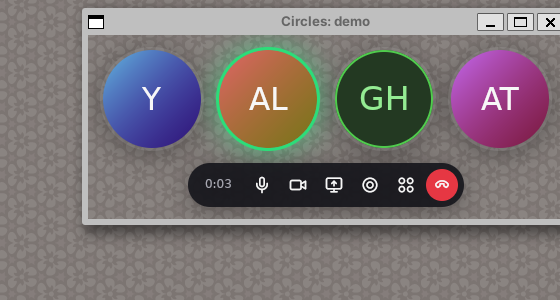

# Circles

A video call app in the style of [Around](https://www.around.co): small round
video bubbles that float over your work, with compact controls. The desktop UI
uses [GPUI](https://www.gpui.rs), the UI framework of the Zed editor.



> Status: UI scaffold. The call uses a simulated room with fake guests.
> Real audio and video (LiveKit) is the next step. See [docs/PLAN.md](docs/PLAN.md).

## What works now

- A start window: start a call with a new room code, or join the demo room.
- A frameless, transparent, always-on-top call window.
- One round bubble per person. The bubble shows video (a placeholder for now) or initials.
- A green ring on people who speak, and a glow on the loudest speaker.
- Badges for "muted" and "sharing the screen". Names show when you hover a bubble.
- Controls: mute, camera, screen share, bubble size (S/M/L), row or column, leave.
- Drag the bubbles to move the window. The window resizes when people join.
- Keyboard: `Ctrl/Cmd+D` mute, `Ctrl/Cmd+E` camera, `Ctrl/Cmd+Shift+H` leave.

## Run

You need Rust 1.85 or newer.

```sh
cargo run            # start window
cargo run -- --demo  # go straight into the demo call
cargo test
```

On Linux, install the GPUI system libraries first (Debian or Ubuntu):

```sh
sudo apt-get install libxkbcommon-dev libxkbcommon-x11-dev libwayland-dev \
  libvulkan-dev libasound2-dev libx11-xcb-dev libxcb-xkb-dev libfontconfig-dev \
  libssl-dev libzstd-dev pkg-config clang
```

On Linux, the window is transparent only when a compositor runs.

## Code layout

| Path | What it does |
| --- | --- |
| `src/call.rs` | Call state: participants, mute, layout, window size. No GPUI, so it is easy to test. |
| `src/media.rs` | `RoomBackend` trait and `SimulatedRoom`. LiveKit will be a second backend. |
| `src/ui/lobby.rs` | Start window. |
| `src/ui/call_window.rs` | Floating call window, actions, and key bindings. |
| `src/ui/bubble.rs` | One participant bubble. |
| `src/ui/controls.rs` | Round icon buttons and tooltips. |
| `src/ui/theme.rs` | Colors and shadows. |
| `assets/icons` | SVG icons, embedded in the binary. |

## Known issues

- `Cargo.lock` pins `libc` to 0.2.186. Newer `libc` removes `ENOATTR`, and the
  `xattr` 0.2 crate that GPUI 0.2.2 uses does not compile without it.
- GPUI cannot move a window from code. The window opens with space for four
  bubbles and grows to the right.
